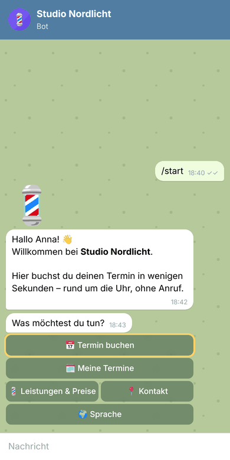
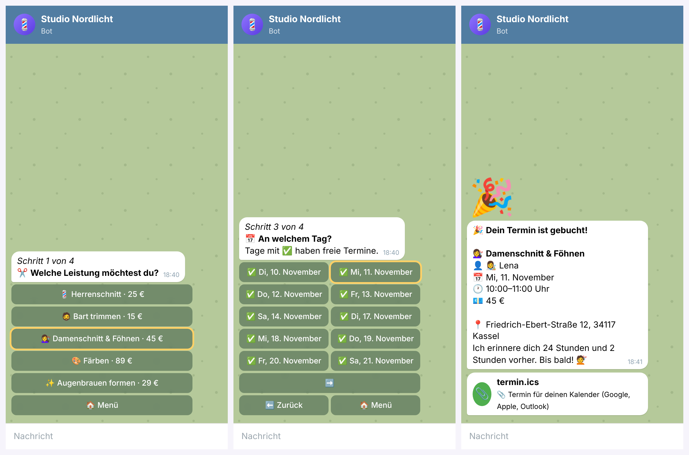
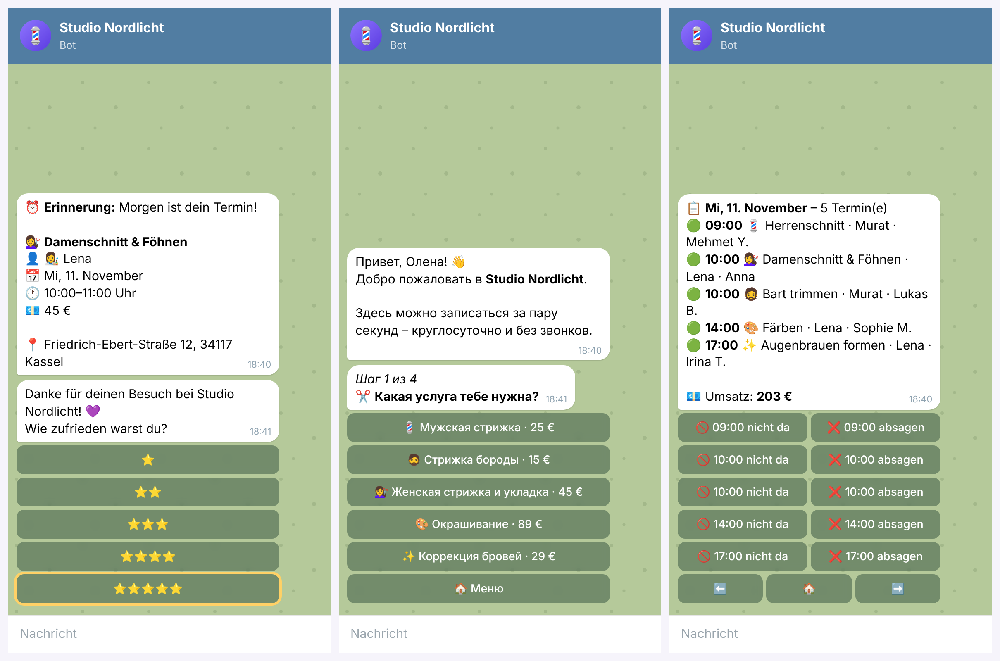
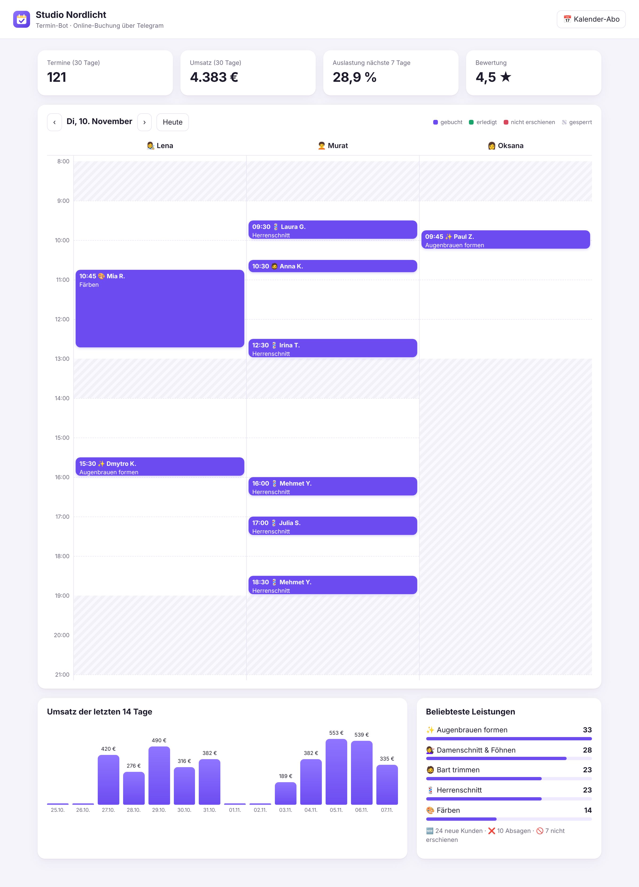
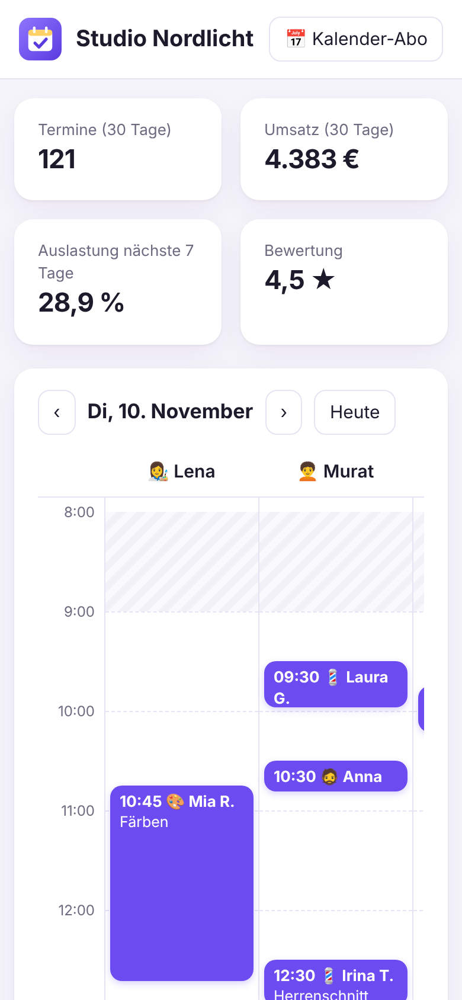

# Termin-Bot 💈📅

**Online-Terminbuchung für Friseure, Barbershops und Kosmetikstudios – direkt in Telegram.**
Kunden buchen in vier Klicks rund um die Uhr. Der Bot erinnert automatisch, füllt abgesagte Termine über eine Warteliste wieder auf und zeigt dem Inhaber Tagesplan, Umsatz und Auslastung.

[](https://github.com/arsenii-prudnikov/telegram_bot_for_barbershop/actions/workflows/ci.yml)


*English version below ↓*

<p align="center"></p>

---

## Das Problem

In vielen kleinen Salons klingelt ständig das Telefon – mitten im Haarschnitt. Termine stehen in einem Papierkalender, Kunden vergessen ihre Termine, und wenn jemand kurzfristig absagt, bleibt der Platz leer. Professionelle Buchungsportale kosten monatlich Gebühren und Provision pro Termin.

## Die Lösung

| Vorher | Mit dem Termin-Bot |
|---|---|
| Buchen nur zu Öffnungszeiten per Telefon | Buchen 24/7 in Telegram – in 4 Klicks |
| Unterbrechungen bei der Arbeit | Telefon bleibt ruhig, der Bot erledigt das |
| Vergessene Termine (No-Shows) | Automatische Erinnerung 24 h und 2 h vorher |
| Absage = leerer Platz | Warteliste: der nächste Kunde wird sofort benachrichtigt |
| Bewertungen kommen selten | Nach dem Besuch fragt der Bot nach Sternen; Zufriedene bekommen den Google-Link, Unzufriedene landen direkt beim Inhaber |
| Kein Überblick über Zahlen | Dashboard mit Tagesplan, Umsatz, Auslastung und Top-Leistungen |

## Funktionen

**Für Kunden (Telegram)**
- 💈 Leistung → 👤 Mitarbeiter (oder „egal“) → 📅 Tag → 🕐 Uhrzeit → ✅ fertig
- Freie Zeiten werden live berechnet: Öffnungszeiten, Mittagspause, eigene Arbeitszeiten der Mitarbeiter, Dauer der Leistung, Puffer zwischen Kunden, Vorlaufzeit, Feiertage und Sperrzeiten
- Bei „egal“ verteilt der Bot Termine gleichmäßig im Team
- Termin als `.ics`-Datei für Google, Apple und Outlook
- 🗓 „Meine Termine“: selbst verschieben oder absagen (bis X Stunden vorher, einstellbar)
- 🔔 Warteliste für ausgebuchte Tage
- ⏰ Erinnerungen 24 h und 2 h vorher, danach Bewertung mit ⭐
- 🌍 Fünf Sprachen: Deutsch, Russisch, Ukrainisch, Englisch, Türkisch – automatisch nach Telegram-Sprache
- Animierte Emojis und klare Schritte („Schritt 2 von 4“) statt langer Texte

**Für Inhaber**
- 🆕 Sofortige Nachricht bei jeder Buchung, Verschiebung und Absage
- 👑 `/admin` in Telegram: Tagesplan, Woche, Statistik, „nicht erschienen“, Termin absagen (Kunde wird informiert)
- ⛔ `/sperren 2026-12-02 12:00-14:00 lena Arzttermin` – Urlaub, Pausen, Fortbildung
- 🖥 Web-Dashboard (auch auf dem Handy) mit Zeitplan pro Mitarbeiter, Umsatz der letzten 14 Tage und Kennzahlen
- 📅 Kalender-Abo (`/kalender.ics`) – alle Termine erscheinen im Handykalender des Inhabers
- ⚙️ Ein Salon wird nur über eine YAML-Datei eingerichtet – ohne Programmieren

## Screenshots

**Buchung in Telegram**



**Erinnerung & Bewertung · Russisch · Tagesplan für den Inhaber**



**Web-Dashboard**



<p align="center"></p>

## Schnellstart

### 1. Dashboard mit Demo-Daten ansehen (ohne Telegram)

```bash
git clone https://github.com/arsenii-prudnikov/telegram_bot_for_barbershop.git
cd telegram_bot_for_barbershop
python -m venv .venv && source .venv/bin/activate   # Windows: .venv\Scripts\activate
pip install -r requirements.txt
python -m termin_bot demo
```

Dann **http://127.0.0.1:8080** öffnen.

### 2. Eigenen Bot starten

1. In Telegram **@BotFather** öffnen → `/newbot` → Namen vergeben → Token kopieren.
2. `.env.example` nach `.env` kopieren und `BOT_TOKEN` eintragen.
3. `salon.example.yaml` nach `salon.yaml` kopieren und Salon, Leistungen, Team und Öffnungszeiten anpassen.
4. Starten:
   ```bash
   python -m termin_bot check   # Konfiguration prüfen
   python -m termin_bot run     # Bot + Dashboard
   ```
5. Im Bot `/id` senden, die eigene ID als `ADMIN_IDS` in `.env` eintragen und neu starten – jetzt funktioniert `/admin`.

### 3. Dauerhaft auf einem Server (Docker)

```bash
cp .env.example .env && cp salon.example.yaml salon.yaml   # anpassen
docker compose up -d --build
```

Läuft auf jedem kleinen Server oder Raspberry Pi – der eigene Computer muss nicht eingeschaltet bleiben. Die Datenbank liegt in `./data`.

## Salon einrichten

```yaml
oeffnungszeiten:
  mo: zu
  di: "09:00-13:00, 14:00-19:00"
  sa: "09:00-15:00"

regeln:
  raster_minuten: 15      # Startzeiten im 15-Minuten-Takt
  puffer_minuten: 5       # Pause zwischen zwei Kunden
  vorlauf_minuten: 120    # frühestens 2 Stunden im Voraus
  buchbar_tage: 21
  storno_stunden: 3       # bis 3 Stunden vorher selbst absagen

leistungen:
  - id: herrenschnitt
    emoji: "💈"
    dauer: 30
    preis: 25
    name: {de: "Herrenschnitt", ru: "Мужская стрижка", tr: "Erkek saç kesimi"}

team:
  - id: murat
    name: "Murat"
    leistungen: [herrenschnitt, bart]
```

Vollständiges Beispiel: [`salon.example.yaml`](salon.example.yaml)

| Variable | Bedeutung |
|---|---|
| `BOT_TOKEN` | Token vom @BotFather |
| `ADMIN_IDS` | Telegram-IDs der Inhaber (kommagetrennt) |
| `SALON_FILE` | Salon-Konfiguration (Standard: `salon.yaml`) |
| `DATABASE` | SQLite-Datei (Standard: `data/termine.db`) |
| `DASHBOARD_TOKEN` | Passwort für das Dashboard: `http://server:8080/?t=PASSWORT` |
| `REVIEW_URL` | Link zur Google-Bewertung |

## So funktioniert es

```
Telegram  ──►  bot/handlers.py  ─┐
                                 ├──►  booking.py  ──►  slots.py   (freie Zeiten)
Dashboard ──►  web/app.py  ──────┘         │
                                           └──────►  db.py (SQLite)
Erinnerungs-Job (jede Minute) ──► booking.due_reminders()
```

Die Geschäftslogik (`booking.py`, `slots.py`) kennt kein Telegram. Dadurch ist sie vollständig getestet und könnte genauso für WhatsApp oder eine Website genutzt werden.

```
termin_bot/
├── salon.py        # YAML-Konfiguration: Leistungen, Team, Öffnungszeiten
├── slots.py        # Berechnung freier Termine
├── booking.py      # Buchen, Verschieben, Absagen, Warteliste, Erinnerungen, Statistik
├── db.py           # SQLite
├── i18n.py         # Übersetzungen (locales/*.yaml)
├── ics.py          # Kalenderdateien
├── bot/            # aiogram 3: Kunden-Dialog, Inhaberbereich, Tastaturen
├── web/            # FastAPI-Dashboard
└── demo.py         # erfundene Demo-Daten
tests/              # 42 automatische Tests
```

## Tests

```bash
pip install -r requirements-dev.txt
pytest
```

Die Tests prüfen die Terminberechnung (Pausen, Puffer, Feiertage, Sperrzeiten, Teamverteilung), Doppelbuchungen, Absagefristen, Warteliste, Erinnerungen, alle fünf Sprachen, Kalenderdateien, das Dashboard – und komplette Telegram-Dialoge von `/start` bis zur Buchung mit einer simulierten Telegram-Verbindung. Bei jedem Push laufen sie über GitHub Actions auf Python 3.11, 3.12 und 3.13.

Screenshots und GIF neu erzeugen: `python scripts/render_demo.py`

> Salon, Mitarbeiter und Kunden in den Beispielen sind frei erfunden.

## Ideen für die Weiterentwicklung

- WhatsApp-Anbindung über die WhatsApp Business API
- Anzahlung bei Buchung (z. B. über Stripe) gegen No-Shows
- Synchronisierung mit Google Calendar in beide Richtungen
- Mehrere Salons in einer Installation

---

## English

**Termin-Bot** is a Telegram booking bot for hair salons, barbershops and beauty studios. Customers pick a service, a staff member (or "anyone"), a day and a time – the bot computes free slots from opening hours, breaks, individual staff schedules, service duration, buffers, holidays and blocked times.

- Automatic reminders 24 h and 2 h before, then a star rating – happy customers get the Google review link, unhappy ones are routed to the owner
- Waiting list: when someone cancels, the next customer is notified instantly
- Self-service rescheduling and cancellation with a configurable deadline
- `.ics` calendar files and an iCal subscription feed for the owner
- Owner area in Telegram (`/admin`, `/sperren`) and a responsive web dashboard with schedule, revenue and utilization
- Five languages: German, Russian, Ukrainian, English, Turkish
- Configured with a single YAML file – no coding needed per salon
- Stack: Python, aiogram 3, FastAPI, SQLite, vanilla JS · 42 tests (including full simulated Telegram dialogs) · GitHub Actions · Docker

Quick start: `pip install -r requirements.txt && python -m termin_bot demo`, then open http://127.0.0.1:8080.

---

**Autor:** Arsenii Prudnikov · Kassel · [arseniiprudnikov@gmail.com](mailto:arseniiprudnikov@gmail.com)
Lizenz: [MIT](LICENSE)
